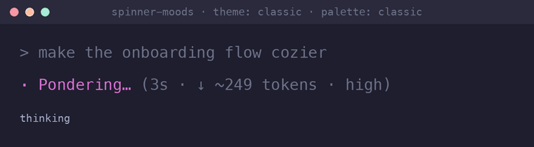

# spinner-moods

A Claude Code mod that colors and animates the spinner line by what Claude is doing, so you can tell at a glance whether it's thinking, running tools, or doing something else. When Claude errors, the spinner will shake more violently and turn red.

Pick a theme and palette to make it yours! 



| State | Classic color | Classic icons |
| --- | --- | --- |
| Inference (thinking, requesting, responding) | magenta | `· ✢ ✳ ✶ ✻ ✽` pulse |
| Tool calls (writing tool input, running a tool) | cyan | `◐ ◓ ◑ ◒` spin |
| Other (status messages such as compacting) | yellow | `◇ ◈ ◆` flicker |

The line reads like `◐ Sauteing… (12s · ↓ ~340 tokens · high)`: the icon and word in the state's color, then the elapsed time, tokens, and effort dimmed. Tokens are exact for finished model requests and estimated (about 4 characters per token) for the one still streaming. Only the main agent's tokens are counted.

Terminal only; the desktop app and VS Code keep their own spinner.

## Install

At the prompt of a Claude Code terminal session:

```
/plugin install spinner-moods --marketplace tatianajiselle/claude-plugins
```

Answer `y` to add the marketplace, then pick a scope.

From a shell:

```
claude plugin install spinner-moods --marketplace tatianajiselle/claude-plugins
```

## Make it yours

Open `/plugin`, pick **spinner-moods**, and change any of these. The spinner updates right away.

| Option | Choices |
| --- | --- |
| **Theme** | `classic` ✢ ◐ ◇ · `sparkle` ⋆ ✧ ✦ · `hearts` ♡ ♥ · `moon` ◔ ◑ ◕ · `geometric` ◧ ▲ ◆ |
| **Palette** | `classic` · `pastel` · `neon` · `cozy` · `mono` (your terminal's own text color) |
| **Speed** | `calm` · `normal` · `zippy` |
| **Details** | `full` (time, tokens, effort) · `time` · `minimal` (just the icon and word) |
| **Reactions** | on or off |

### Reactions

- **Flustered:** after a tool call fails, the spinner turns red (or your palette's alarm color) and wobbles for a few seconds before calming down.
- **Sleepy:** when nothing has changed for a minute, such as during a slow command or a long wait on the API, the icon dozes and the line adds `zzz`. It wakes up as soon as something happens.

### Going further

The themes and palettes live in `hooks/moods.ts`. Add a row to `THEMES` or `PALETTES` and its key to the matching `options` list in `.claude-plugin/plugin.json`. A color is a name (`red`, `cyan`), a hex value (`#ff8800`), or a theme key (`claude`, `warning`, `success`).

The demo GIF is drawn from `hooks/moods.ts` by `scripts/render-spinner-demo.py` at the repo root, so it always matches the real frames. Rerun it after changing a theme (needs Pillow and ffmpeg).
